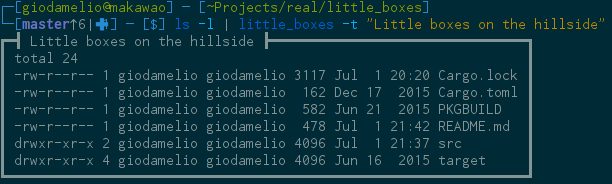

# Little Boxes
[](https://github.com/giodamelio/little_boxes/actions/workflows/ci.yml)
[](https://crates.io/crates/little_boxes)
[](https://github.com/giodamelio/little_boxes/blob/master/LICENSE) 

Adds boxes around stdin. Optionally adds a title.



# Installation

```sh
# From crates.io
$ cargo install little_boxes

# Try it out with Nix flakes
$ echo "Hello World" | nix run github:giodamelio/little_boxes
```

The Nix package installs the man page and shell completions. With `cargo install`, generate them yourself, for example:

```sh
$ little_boxes completions zsh > "${fpath[1]}/_little_boxes"
$ little_boxes man > ~/.local/share/man/man1/little_boxes.1
```

`completions` accepts `bash`, `elvish`, `fish`, `nushell`, `powershell` and `zsh`.

# Usage

```console
$ little_boxes --help
Adds boxes around stdin. Optionally adds a title

Usage: little_boxes [OPTIONS]
       little_boxes <COMMAND>

Commands:
  draw         Draw a box around the input (the default)
  completions  Print a shell completion script
  man          Print the man page
  help         Print this message or the help of the given subcommand(s)

Options:
  -t, --title <TITLE>        Add a title to the box
  -c, --charset <CHARSET>    The charset to draw the box with [default: thick] [possible values: thick, thin, double, box, rounded, dot, ascii]
  -f, --file <FILE>          Read input from a file instead of stdin
      --all                  Compare all charsets
      --border-color <SPEC>  Color the border: a name like red or bright-blue, a 256-color index 0-255, or #rrggbb
      --color <WHEN>         When to color the border [default: auto] [possible values: auto, always, never]
  -h, --help                 Print help
  -V, --version              Print version

```
